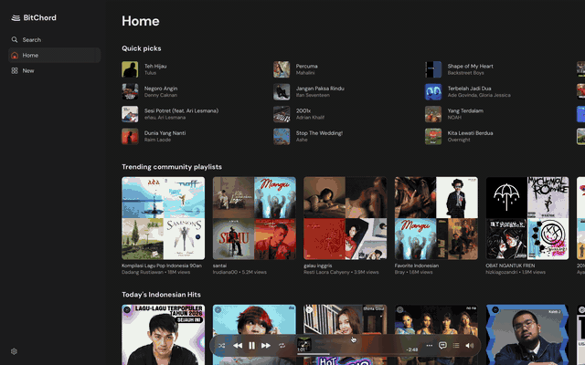

# BitChord Lite

A lightweight macOS desktop player for YouTube Music, derived from [BitChord](https://github.com/kushagrasinghx/BitChord).

BitChord Lite keeps the BitChord web player's UI and playback engine, wraps it in a Tauri 2 shell, and replaces the Chrome extension with a local Rust bridge. The goal is an installable `.dmg` that is lighter than an Electron app and can play audio-only sources.

- Upstream: https://github.com/kushagrasinghx/BitChord
- Source fork: https://github.com/sigidpam/BitChord
- License: GPLv3
- Status: **v0.3 development.** Native YouTube Music playback, the device library, back navigation, sound quality, and native Google sign-in are on `main`. The latest tagged release is [v0.2.0](https://github.com/sigidpam/bitchord-lite/releases/tag/v0.2.0) (ad-hoc signed, not notarized); source picker UI, local files, and Spotify remain the next stage.



*Home, playback, full-screen lyrics, and browsing in the native macOS build.*

## Why a native bridge

The original web player depends on its Chrome MV3 extension for YouTube requests, cookies, BotGuard/PO tokens, stream headers, Spotify, and Discord. Tauri's WKWebView cannot load Chrome extensions.

The Tauri app therefore uses:

- **React/Vite UI** from BitChord, rendered in the Tauri WebView.
- **Rust local bridge** for the network and auth work the extension used to do.
- **A page-side fetch proxy** that sends every YouTube/googlevideo request through the bridge, because WKWebView has no declarativeNetRequest.

The extension source is kept in the repository as the reference implementation; it is not loaded by the shipping app.

The bridge listens on `127.0.0.1:47823` only and exposes:

| Route | Purpose |
|---|---|
| `GET /health` | Liveness check |
| `POST /bridge` | The same versioned bridge envelope the extension used (`ping`, `yt.fetch`, `yt.authState`, `yt.signIn`) |
| `GET/POST/HEAD /proxy?url=…` | YouTube/googlevideo proxy: adds the Origin/Referer/X-Origin headers the extension's DNR rules added; streams media and forwards `Range` |
| `POST /log` | Dev-only mirror of the page's track log into the terminal |

The bridge only reaches `youtube.com`, `*.youtube.com`, `googlevideo.com`, and `*.googlevideo.com`; it is not a general proxy.

## Architecture

```text
┌──────────────────────────────────────────────┐
│ Tauri 2 shell (Rust)                         │
│                                              │
│  WKWebView                                   │
│   React UI (BitChord web player)             │
│        │                                     │
│        │ native bridge shim                  │
│        ▼                                     │
│  Rust bridge                                 │
│   • InnerTube / YouTube Music requests       │
│   • googlevideo audio proxy                  │
│   • BotGuard / PO token forwarding           │
│   • Spotify session bridge (planned)         │
│   • lyrics providers (planned)               │
│   • Discord IPC (planned)                    │
│   • local file server (planned)              │
└──────────────────────────────────────────────┘
```

### Light profile

- Audio-only streams by default; video playback is opt-in.
- Video canvas, AutoMix/ONNX analysis, and other heavy features are lazy-loaded or disabled by default.
- Rust handles proxying and media; the WebView only renders the UI and audio engine.
- No bundled Chromium.

## Sources

The planned source picker covers:

- YouTube Music audio
- YouTube video audio
- Local files
- Spotify (embedded login/session)

YouTube Music is working today; any YouTube video id or URL can be played from the Debug page. The picker itself, local files (Tauri file picker plus a local media route), and Spotify (embedded login/session) are the next implementation stage.

## What works in this build

- Tauri 2 desktop shell with the BitChord UI.
- Native bridge speaking the existing bridge protocol; no browser extension.
- YouTube Music home feed, search, browse, autoplay radio, and audio playback (anonymous, or as the signed-in account).
- Native Google sign-in in its own app window; cookies stay in the WebView and are used by the Rust bridge.
- Back navigation above the page title, plus `Cmd+[` and `Alt+Left`.
- **Sound Quality**: Low, Medium, High, and Lossless. YouTube has no lossless stream, so Lossless uses the best available audio until a lossless source is added.
- BotGuard / WebPO token flow: the page runs BotGuard, the bridge forwards `Create`/`GenerateIT`.
- Audio playback through proxied googlevideo streams (verified with VISIONOS direct audio in WKWebView: Opus 251, 206 range responses).
- Device-local **Favorite Songs**, **Saved Albums**, and **Saved Playlists**, persisted in the WebView. Favorites and saves are mirrored to YouTube Music when a signed-in session exists.
- Any YouTube video can be played by id or URL from the Debug page (`/debug`, or `?play=<id or URL>` in the desktop dev build).
- Unsigned `.app` / `.dmg` build.

Not in this build yet: in-app source picker, local files, Spotify playback, lyrics, downloads, Discord, Last.fm, and Listen Together parity. Age-gated playback depends on the signed-in session and is not covered by automated tests.

Existing YouTube liked songs and playlists are not imported into the device library; signed-in users browse them in the YouTube Library sections.

## Repository layout

```text
web/            React/Vite UI and playback code (GPLv3, from BitChord)
src-tauri/      Rust Tauri shell and native bridge
LICENSE         GPLv3
README.md
```

## Build locally

Requirements:

- macOS 12 or newer
- Node.js 22+
- pnpm (through corepack)
- Rust stable (rustup)
- Xcode Command Line Tools

```bash
corepack pnpm install
corepack pnpm --dir web install
printf 'VITE_PARTY_SERVER_URL=https://bitchord-listen-together.onrender.com\n' > web/app/.env.local
corepack pnpm tauri dev
```

Production build:

```bash
corepack pnpm tauri build
```

The app enters native mode automatically: the Tauri config runs the web build with `VITE_BITCHORD_NATIVE=1`, so the page talks to the bundled Rust bridge instead of looking for the extension. The bridge only listens on loopback.

The build is **unsigned** by default. The DMG is written under `src-tauri/target/release/bundle/dmg/`; on another Mac it needs the Gatekeeper bypass described below.

To build a universal (Intel + Apple Silicon) DMG:

```bash
rustup target add aarch64-apple-darwin x86_64-apple-darwin
corepack pnpm tauri build --target universal-apple-darwin
```

The universal artifacts are written under `src-tauri/target/universal-apple-darwin/release/bundle/`.

## Signing and notarization

Signing is optional for development; the current build is unsigned. If you have a paid Apple Developer Program membership, these are the steps for a clean, notarized DMG.

1. Install the certificate in the login Keychain and verify:

```bash
security find-identity -v -p codesigning
```

2. Store notarization credentials once (app-specific password, not the Apple ID password):

```bash
xcrun notarytool store-credentials "bitchord-lite" \
  --apple-id "you@example.com" \
  --team-id "TEAMID" \
  --password "app-specific-password"
```

3. Build with the Developer ID identity configured in `src-tauri/tauri.conf.json`, then submit the DMG:

```bash
xcrun notarytool submit src-tauri/target/release/bundle/dmg/BitChord-Lite_*.dmg \
  --keychain-profile "bitchord-lite" --wait
xcrun stapler staple src-tauri/target/release/bundle/dmg/BitChord-Lite_*.dmg
```

For local testing without a certificate, an unsigned DMG can be built and opened with right-click → Open.

### Distribution without a paid Developer ID

A Developer ID Application certificate and notarization require the paid Apple Developer Program. If you do not want to pay, these are the practical free routes:

**Unsigned DMG with a bypass**

- Build normally with `corepack pnpm tauri build`. The app is not signed.
- On the Mac that built it, it opens normally.
- On another Mac, the download is quarantined. The user must either:
  - System Settings → Privacy & Security → **Open Anyway**, or
  - remove the quarantine flag:
    ```bash
    xattr -dr com.apple.quarantine "/Applications/BitChord Lite.app"
    ```
- This is the simplest free option, but macOS will show a security warning.

**Ad-hoc signing**

Ad-hoc signing does not provide trust or notarization; Gatekeeper still warns. It can reduce some “app is damaged” failures:

```bash
codesign --force --deep --options runtime --sign - "BitChord Lite.app"
```

**Homebrew cask/tap**

For technical users, a cask can remove the quarantine attribute during install. A tap gives a one-command install without the browser warning:

```ruby
cask "bitchord-lite" do
  version "0.2.0"
  sha256 "REPLACE_WITH_DMG_SHA256"
  url "https://github.com/sigidpam/bitchord-lite/releases/download/v0.2.0/BitChord.Lite_0.2.0_universal.dmg"
  name "BitChord Lite"
  desc "Lightweight YouTube Music player"
  homepage "https://github.com/sigidpam/bitchord-lite"
  app "BitChord Lite.app"
  quarantine false
end
```

**Web/PWA alternative**

The BitChord web player can be installed as a browser app/PWA from Brave or Chrome. No DMG, no Apple fee, and no Gatekeeper. The companion extension still has to be loaded in the browser.

**Fee waiver**

Apple offers fee waivers for accredited educational institutions, nonprofits, and government entities. Individual hobby projects generally do not qualify.

The only route to a DMG that opens cleanly on any Mac without warnings is a paid Developer ID certificate plus notarization. The free routes trade that polish for a manual approval or a technical install path.


## Troubleshooting

**The app shows the extension install banner.** The local bridge did not start, so the native build is behaving like the browser build. Only one process can own `127.0.0.1:47823`. Quit any other BitChord Lite instance and relaunch:

```bash
lsof -nP -iTCP:47823 -sTCP:LISTEN
```

**A track will not play.** Open `/debug` in the running app and read the track log. The page logs every InnerTube client attempt and the streaming result. The resolver tries VISIONOS, YTMUSIC, WEB, and MWEB. In a development build, a per-client override can be set with the localStorage key `bitchord:debug:clients` (for example `YTMUSIC,WEB`).

**The downloaded app is blocked by Gatekeeper.** See “Distribution without a paid Developer ID” above. The DMG is not notarized.

**Sign-in.** Click the Sign In pill in the desktop sidebar. A Google sign-in window opens inside the app; its cookies stay in the app's WebView and the Rust bridge uses them for signed requests. The page never receives the cookies. The embedded sign-in flow is new — if Google refuses it, the browser-extension path still has the original sign-in behavior.

## Attribution and license

BitChord Lite is a derivative of **BitChord**, originally by Kushagra Singh and contributors:

- Upstream: https://github.com/kushagrasinghx/BitChord
- Fork used for this work: https://github.com/sigidpam/BitChord

The BitChord UI, playback engine, and extension reference code are reused under the **GNU General Public License v3.0**. BitChord Lite is distributed under the same license; see `LICENSE`.

BitChord Lite is not affiliated with, endorsed by, or connected to BitChord, YouTube, Google, or Spotify. It does not host media. Users are responsible for their use of third-party services.

## Status

The Tauri shell, native Rust bridge, and anonymous YouTube Music playback are working. This repository is a staged build: it is usable for YouTube Music today, while the source picker, local files, Spotify, sign-in, and the remaining BitChord integrations are still to come. See “What works in this build” above.
